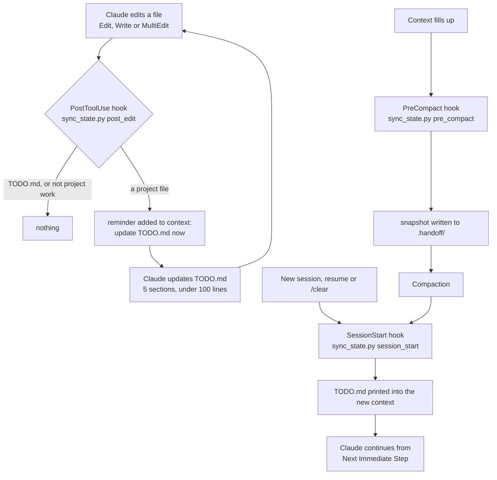

# claude-live-handoff

A Claude Code skill that keeps a live `TODO.md` in your project and hands work over from it: after `/clear`, after compaction, and into new sessions.

Long sessions fill the context window with work that is already finished. When the window is compacted or cleared, Claude loses the thread and re-reads the codebase to find it again. `live-handoff` keeps the thread in a file instead:

- `TODO.md` in the project root always says what the goal is, what is done, what changed last, what was decided, and what to do next.
- Claude updates it after every file edit. A hook reminds it each time.
- When a session starts, is cleared or is compacted, a hook prints `TODO.md` into the new context, and Claude carries on from **Next Immediate Step** without scanning the code again.

## Features

- **One small state file.** `TODO.md`, five fixed sections, kept under 100 lines.
- **Enforced by hooks, not by memory.** The reminder fires after every `Edit`, `Write` and `MultiEdit` on a project file, whether or not the skill's text is still in context.
- **Automatic resume.** `TODO.md` is printed at session start, on resume, after `/clear` and after compaction.
- **Snapshots before compaction.** `.handoff/latest-handoff.md` plus a timestamped copy each time.
- **Cheap.** The reminder is a few short sentences, roughly 100 tokens. The session-start print stays below Claude Code's 10,000-character cap on hook output.
- **Leaves your own `TODO.md` alone.** A `TODO.md` that does not have the five sections is yours: the hooks stay silent in that project.
- **Safe to install and remove.** The installer merges into `settings.json`, backs it up first, changes nothing when run a second time, and has `--uninstall`.
- **Cannot get in the way.** The hook script exits 0 whatever happens, and the hooks do nothing at all if the skill folder is missing.
- **macOS, Linux and Windows** (Git Bash). Python 3.8 or newer, standard library only.

## Before you install

The hooks are installed for your user, so they act in every folder where Claude Code edits a file. In a project with no `TODO.md`, Claude creates one at the first edit. A `TODO.md` that is already there and is not in the live-handoff format is never touched (see [Good to know](#good-to-know)). To keep live-handoff out of a project altogether, see [Switching it off](#switching-it-off).

## How it works



There are three parts:

| Part | File | What it does |
|---|---|---|
| The skill | `skills/live-handoff/SKILL.md` | The rules: the five sections, when to update, how to prune, how to resume. Claude loads it when a reminder or a `TODO.md` calls for it. |
| The script | `skills/live-handoff/scripts/sync_state.py` | One file, three modes, one per hook. |
| The hooks | three entries in `~/.claude/settings.json` | Run the script after edits, at session start and before compaction. |

The hooks are what make it reliable. A skill's text is only in context once Claude has loaded it, and it can be lost again at compaction. A hook runs every time its event happens.

| Mode | Hook | Behaviour |
|---|---|---|
| `post_edit` | `PostToolUse` on `Edit\|Write\|MultiEdit` | Reads the hook's JSON from stdin. If the edited file is project work and is not `TODO.md`, prints a `hookSpecificOutput` object whose `additionalContext` tells Claude to update `TODO.md` before doing anything else. If the project has no `TODO.md` yet, the reminder lists the five sections so Claude can create it. |
| `session_start` | `SessionStart` | If the project root has a live-handoff `TODO.md`, prints it under a clear header. Fires on startup, on resume, after `/clear` and after compaction. |
| `pre_compact` | `PreCompact` | If the project root has a live-handoff `TODO.md`, copies it to `.handoff/latest-handoff.md` and `.handoff/handoff-YYYYMMDD-HHMMSS.md`. Prints nothing, because Claude Code feeds whatever a `PreCompact` hook prints into the compaction summary. |

The project root is `$CLAUDE_PROJECT_DIR`, which Claude Code sets for hooks. If that is missing, the script uses the working directory.

## Install

You need Claude Code, Python 3.8 or newer, git, and bash. On Windows, run the command in Git Bash.

```bash
git clone https://github.com/mata116/claude-live-handoff.git && bash claude-live-handoff/install.sh
```

The installer:

1. finds a Python that really runs (on Windows the first `python` on `PATH` is often the Microsoft Store placeholder);
2. checks that `~/.claude/settings.json` can be read, merged and written, before it copies anything;
3. copies the skill to `~/.claude/skills/live-handoff/`;
4. runs the hook command once as a self-test;
5. merges the three hooks into `~/.claude/settings.json`, after writing a timestamped backup next to it.

Every other setting and hook keeps its value and its place. The file is written back in standard JSON layout with your indentation and line endings, which is the layout Claude Code itself writes, so normally the only difference is the added lines. Hand-made formatting, such as a list kept on one line, is not preserved.

Running the installer again changes nothing. If `settings.json` is not valid JSON or is read-only, the installer stops before it copies anything. If a later step fails on a first install, it removes the files it copied; on an update it leaves the new skill files in place and tells you that the hooks were not changed.

To run it again later, after fixing a problem or after `git -C claude-live-handoff pull` to update, use `bash claude-live-handoff/install.sh`. The one-line command above only works the first time, because the folder then exists.

Claude Code reloads its settings when the file changes, so sessions that are already open pick the hooks up. If `/hooks` does not list the three entries in a session that was already open, restart Claude Code. If `/live-handoff` is not listed yet, run `/reload-skills`.

Later commands use the same script, from wherever you cloned it:

```bash
bash claude-live-handoff/install.sh --uninstall
CLAUDE_CONFIG_DIR=/other/claude/dir bash claude-live-handoff/install.sh
LIVE_HANDOFF_PYTHON=/path/to/python3 bash claude-live-handoff/install.sh
```

The first removes the skill and the three hooks. The second installs into a config folder that is not `~/.claude`. The third chooses the interpreter the hooks use.

### Check that it works

Ask Claude to change a file in any project. It should update `TODO.md` straight after. `/hooks` lists the three hooks. Running the installer again repeats the self-test, which runs the installed hook command exactly as Claude Code will, and reports the result.

## The TODO.md format

```markdown
# TODO

## Current Goal
One or two sentences: what is being built or fixed, and what done looks like.

## Checklist
- [x] Step that is finished
- [ ] Step still to do
- [!] Step that is blocked: what blocks it

## Recent Changes (Max 5)
- `path/to/file`: what changed and why (newest first)

## Key Decisions & Pitfalls
- A decision and its reason, or a trap and how to avoid it

## Next Immediate Step
The single next action, concrete enough to start cold: the file, the function, the command.
```

Every update also prunes: finished steps are folded together, the oldest change drops off, decisions that no longer matter are deleted. The file never grows into the problem it exists to solve.

## What the installer adds to settings.json

With your own paths in place of `/home/you`:

```json
{
  "hooks": {
    "PostToolUse": [
      {
        "matcher": "Edit|Write|MultiEdit",
        "hooks": [
          {
            "type": "command",
            "command": "[ ! -f \"/home/you/.claude/skills/live-handoff/scripts/sync_state.py\" ] || python3 -I \"/home/you/.claude/skills/live-handoff/scripts/sync_state.py\" post_edit",
            "timeout": 15
          }
        ]
      }
    ],
    "SessionStart": [
      {
        "hooks": [
          {
            "type": "command",
            "command": "[ ! -f \"/home/you/.claude/skills/live-handoff/scripts/sync_state.py\" ] || python3 -I \"/home/you/.claude/skills/live-handoff/scripts/sync_state.py\" session_start",
            "timeout": 15
          }
        ]
      }
    ],
    "PreCompact": [
      {
        "hooks": [
          {
            "type": "command",
            "command": "[ ! -f \"/home/you/.claude/skills/live-handoff/scripts/sync_state.py\" ] || python3 -I \"/home/you/.claude/skills/live-handoff/scripts/sync_state.py\" pre_compact",
            "timeout": 15
          }
        ]
      }
    ]
  }
}
```

The `[ ! -f ... ] ||` at the front makes the hook a silent no-op when the script is not there. Without it, a skill folder deleted by hand would make Python exit with code 2, and exit code 2 from a `PreCompact` hook blocks compaction. `-I` runs Python in isolated mode, so a project's own Python files and `PYTHON*` variables cannot interfere with the hook.

On Windows the command holds the full path of the Python interpreter instead of `python3`, because command names are not reliable there. The same is done when `python3` is a version manager's shim (pyenv, asdf, mise).

If you chain a command of your own onto one of these entries, the installer leaves that entry as it is and says so, and `--uninstall` does not remove it either.

To install by hand instead, copy `skills/live-handoff/` to `~/.claude/skills/live-handoff/` and add the three entries above.

## Switching it off

| Scope | How |
|---|---|
| One project | Create an empty file named `.live-handoff-off` in the project root. |
| One session | Start Claude Code with `LIVE_HANDOFF_DISABLE=1` in the environment. |
| Everywhere | `bash claude-live-handoff/install.sh --uninstall` |

While it is switched off, the reminders and snapshots stop, and at session start Claude is told in one line not to keep `TODO.md`.

## Good to know

- **Each change costs a short reminder and one small edit of `TODO.md`.** That is the design: the state is written down while Claude still has it.
- **Your own `TODO.md` is left alone.** A `TODO.md` counts as a live-handoff file when it is empty or has at least three of the five section headings. Any other `TODO.md` is treated as yours: no reminders, no snapshots, and one line at session start saying so. To adopt it, ask Claude to convert it; the skill tells Claude to save the original under another name first.
- **`TODO.md` is an ordinary file.** Commit it if you want the state to travel with the branch, or add it to your `.gitignore`.
- **One folder, one task, one file.** Two Claude Code sessions in the same folder share the same `TODO.md`. A side question does not replace the task in it; Claude rewrites the file only when new work replaces the task, and says so first if open items remain.
- **`.handoff/` ignores itself.** The hook writes a `.gitignore` inside it, so the snapshots never show up in `git status`. Snapshots are small and are not deleted automatically.
- **Subagents do not write `TODO.md`.** Several helpers rewriting one file would collide. A subagent's reminder tells it to report what it changed, and the main session records it. The hook cannot remind the main session about a helper's edits, so that part rests on the skill's rule.
- **Only the edit tools trigger the reminder.** A file changed by a shell command (`sed -i`, `echo >`, a formatter, `git checkout`) does not pass through `Edit` or `Write`, so no hook fires for it. Notebook edits are not matched either; add `NotebookEdit` to the matcher if you want them, the script understands them.
- **Files that are not project work** do not trigger a reminder: anything under `~/.claude` (Claude Code's memory, plans and settings), the session scratchpad, the system temp folder, and the snapshots in `.handoff/`. A project that itself lives in one of those folders still gets reminders for its own files.
- **`MultiEdit`** is in the matcher for older Claude Code versions. Current versions edit files with `Edit` and `Write`.
- **Hooks only run in folders you have trusted** in Claude Code. `TODO.md` is printed into Claude's context at session start, much as a project's `CLAUDE.md` is, so the same care applies to repositories you did not write.

## Uninstall

```bash
bash claude-live-handoff/install.sh --uninstall
```

This removes the three hooks from `settings.json` (again with a backup) and deletes the skill's files. `TODO.md` and `.handoff/` in your projects are left alone.

## Repository layout

```
claude-live-handoff/
├── README.md
├── LICENSE                         MIT
├── install.sh                      installer and uninstaller
├── .gitignore
├── .gitattributes                  keeps LF line endings on the scripts
└── skills/
    └── live-handoff/
        ├── SKILL.md                the skill
        └── scripts/
            └── sync_state.py       the three hook modes
```

## Troubleshooting

- **Nothing happens after an edit.** Run `/hooks` and look for the three entries. Check that the folder is trusted, that `disableAllHooks` is not set, and that the project does not hold a `TODO.md` of its own or a `.live-handoff-off` file. `claude --debug` writes a log that shows each hook run.
- **"no working Python 3.8 or newer was found".** Install Python 3, or run the installer with `LIVE_HANDOFF_PYTHON` set to the interpreter you want.
- **A hook error in one project only.** If `python3` comes from a version manager, the project may ask for a version that is not installed. Run the installer once more with `LIVE_HANDOFF_PYTHON=/usr/bin/python3` (or another fixed interpreter).
- **You moved or reinstalled Python.** Run `bash claude-live-handoff/install.sh` again: it rewrites the interpreter in the three hooks and changes nothing else.
- **You want your old settings back.** The backups are next to the file: `settings.json.live-handoff-YYYYMMDD-HHMMSS.bak`.

## License

MIT. See [LICENSE](LICENSE).
